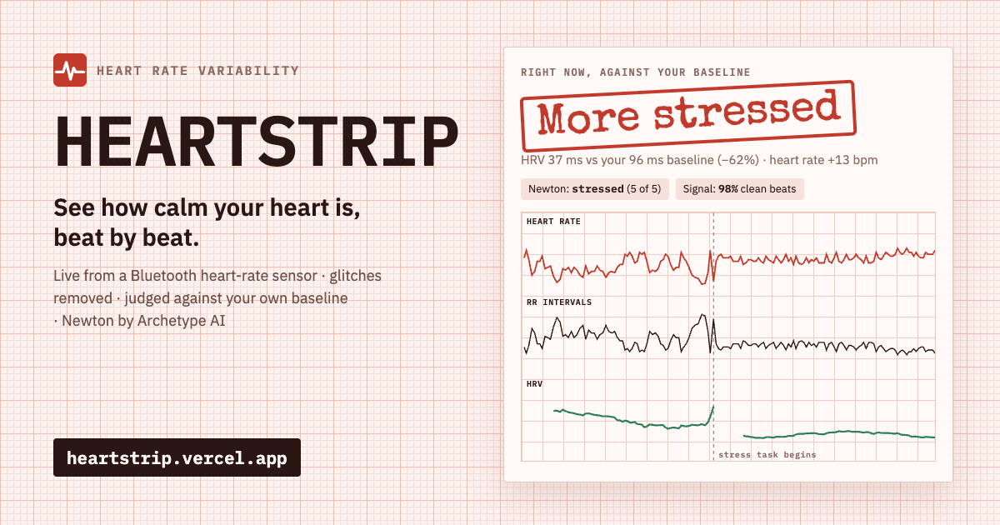
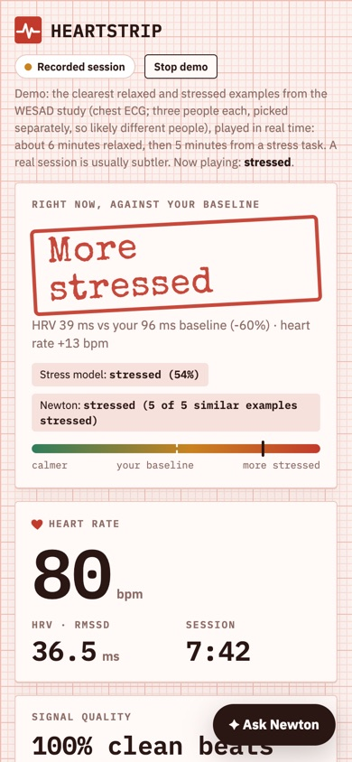
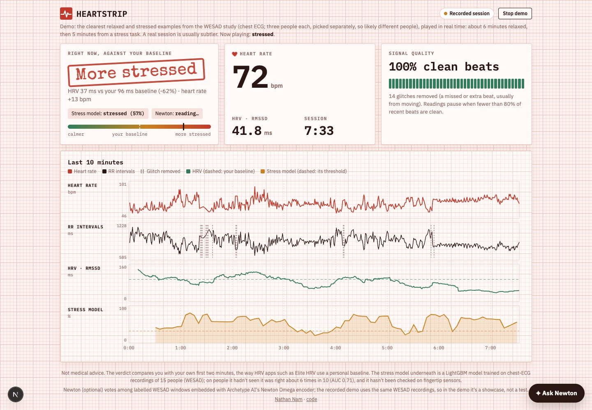

# Heartstrip

**Live heart rate variability from a Bluetooth heart-rate sensor, printed like an ECG strip.** It cleans out sensor glitches, reads your stress against your own baseline, and adds a second opinion from Newton by [Archetype AI](https://www.archetypeai.io/).



The time between heartbeats keeps changing. When you're relaxed it varies more; under stress it gets more regular. That variation is HRV. Heartstrip reads it beat by beat in the browser, with no app and no account.

<p>
  
  
</p>

## What it does

- **Connects to your sensor in the browser** with Web Bluetooth (Chrome or Edge, on a laptop or Android). It works with any sensor using the standard Heart Rate profile that reports beat-to-beat (RR) intervals, e.g.:
  - Elite HRV CorSense (the fingertip sensor this was built with)
  - Polar H10 / H9 / Verity Sense
  - Garmin HRM-Pro
  - Wahoo TICKR
- **Removes glitches.** A moving finger or poor contact makes missed or extra beats, and a single bad beat can double the HRV.
  - **What counts as a glitch:** a beat that's physically impossible, or further from the recent beats than your own beat-to-beat variation allows. That limit is 5.2 quartile deviations of recent changes, never below 20%, as in Kubios (Lipponen & Tarvainen 2019).
  - **What you see:** each glitch is shown as a dashed tick, and a signal-quality score tracks them.
  - **When readings pause:** if fewer than 80% of the last 30 seconds' beats are clean.
- **Judges you against yourself.** HRV differs hugely between people, so the first two minutes set your baseline, as Elite HRV and similar apps do. After that, the stamp reads **Calmer**, **Steady** or **More stressed** from your HRV (RMSSD) and heart rate against that baseline.
- **Gives two second opinions:**
  - **Stress model:** a LightGBM model running in the browser, from 18 HRV features over 30 seconds.
  - **Newton:** the last 64 beats are embedded with Archetype AI's Newton Omega encoder, then it takes a vote of the 5 most similar labelled windows.
- **Lets you ask Newton.** Newton's C 2.6 fusion model looks at your timeline and answers questions such as "Am I stressed?" in about two seconds.
- **Has a demo for anyone without a sensor.** It replays the clearest relaxed and stressed examples from the WESAD study in real time, and you can jump to the stress part. The examples come from three people for each state, picked separately, so a real session is usually subtler.

Not medical advice.

## Run it

```bash
cd web
npm install
npm run dev        # http://localhost:3000
npm test           # glitch filter and baseline verdict
```

Open it in Chrome or Edge. Safari and Firefox (and every iPhone browser) lack Web Bluetooth, so use **Play a recorded session** there.

### Newton (optional)

Newton uses Archetype AI's stateless **direct query** endpoint: one `POST /api/lens/query` per question or window, with no sessions, uploads or streams. That's why the app runs fine on serverless hosting.

- **Visitors bring their own key.** They paste an Archetype AI key into the Newton drawer. It stays in that browser tab's memory, is never stored or logged, and goes to Archetype AI only through this site's `/api/newton/*` routes.
- **Or give the server a key.** Put one in `web/.env.local` (git-ignored) and Newton is on for everyone:

  ```
  ATAI_API_KEY=your_key
  # optional; this is the default:
  ATAI_API_ENDPOINT=https://platform.u1.archetypeai.app
  ```

  An old `https://api.u1.archetypeai.app/v0.5` value is ignored, because the session-based v0.5 API is the old one.

| | Model | Input | Output | Speed |
|---|---|---|---|---|
| Ask Newton | `Newton::c2_6_8b_fp8_260424d7a55d5e` (fusion) | the timeline as a PNG + the current numbers as text | a short answer | ~2 s |
| Newton's reading | `OmegaEncoder::omega_embeddings_1_4` (Newton Omega encoder) | the last 64 RR intervals, one channel, scaled once with the example pool's mean and SD (`normalize_input: false`) | 768-d embedding → majority of 5 nearest labelled windows | ~2 s (first call ~10 s while 30 example windows are embedded) |

Following Archetype AI's [`atai-newton-omega-model`](https://github.com/archetypeai/agent-skills/blob/main/skills/atai-newton-omega-model/SKILL.md) skill, every window is one contiguous series:
- **Example windows** stay inside one person's recording.
- **In live windows**, a glitch is replaced by the median of the five clean beats before it rather than leaving a hole.

**How well Newton does:** judging each of the six example people only against the other five, Newton got **29 of 30 windows** right. Those are WESAD's clearest examples, so expect less on an ordinary session. In the demo, Newton has already seen these exact recordings.

The [`atai-newton-fusion-model`](https://github.com/archetypeai/agent-skills/blob/main/skills/atai-newton-fusion-model/SKILL.md) skill covers the chat request:
- the system prompt goes in `instruction_prompt`
- images are inline `data.base64_img` events
- the answer comes back as a one-item list

## How it fits together

```
Bluetooth sensor ──RR──▶ BeatCleaner ──▶ clean beats ─┬─▶ RMSSD, heart rate ──▶ personal baseline ──▶ stamp
 (or the WESAD demo)       (glitch flags,             ├─▶ 18 HRV features ──▶ LightGBM (in browser)
                            signal quality)           └─▶ 64-beat window ──▶ /api/newton/classify ──▶ Newton Omega encoder + KNN
timeline (SVG) ──PNG──▶ /api/newton/ask ──▶ Newton C 2.6 fusion model
```

```
web/
  app/page.tsx              the dashboard
  app/api/newton/           ask · classify · status (server; key from header or env)
  components/strip.tsx      start screen, stamped verdict, heart, signal quality, Newton drawer
  components/timeline.tsx   heart rate, RR, HRV and stress on one time axis; PNG export for Newton
  hooks/use-heart-rate.ts   Web Bluetooth, glitch cleaning, demo playback
  hooks/use-stress-prediction.ts  LightGBM every 5 s of session time, on clean beats
  hooks/use-newton.ts       bring-your-own key (tab memory), chat, Newton's reading every 15 s
  lib/rr-clean.ts           the glitch filter
  lib/baseline.ts           personal baseline and the Calmer / Steady / More stressed reading
  lib/atai.ts               Archetype AI direct query client
  lib/omega-knn.ts          Newton Omega encoder embeddings + n-shot KNN
  lib/hrv-features.ts, stress-predictor.ts, stress-model-data.json   the in-browser model
  public/demo/wesad-session.json   demo beats and Newton's examples
  scripts/brand.mjs         favicon set and share image
connect.py, scan.py         command-line BLE tools (python connect.py streams HR + RR)
train_stress_model.py, export_model_trees.py   train the LightGBM model, export it for the browser
experiments/legacy-lens/    the earlier session-based Newton experiments, kept for reference
```

## The stress model

LightGBM, 100 trees of depth 3, on 18 HRV features over 30-second windows:
- **Time-domain:** mean RR, SDNN, RMSSD, pNN50, heart-rate statistics.
- **Poincaré:** SD1, SD2.
- **Frequency-domain:** LF/HF power from a Lomb-Scargle periodogram.

It was trained and tested leave-one-subject-out on 15 WESAD subjects (chest ECG), stress vs. baseline + amusement:

| AUC | F1 | Accuracy | Precision | Recall |
|---|---|---|---|---|
| 0.708 | 0.575 | 0.618 | 0.456 | 0.778 |

Its 0.29 threshold was tuned for F1, which favours catching stress over false alarms. On the demo it scores the relaxed and stressed examples at a median of 0.56 and 0.60, so it barely tells them apart. That's why the stamp comes from your own baseline and the model is a second opinion. It hasn't been checked on fingertip sensors.

To retrain:
1. Download WESAD from [UCI](https://archive.ics.uci.edu/dataset/465/wesad+wearable+stress+and+affect+detection) or [Kaggle](https://www.kaggle.com/datasets/orvile/wesad-wearable-stress-affect-detection-dataset).
2. Extract it to `data/WESAD/S2/`, `data/WESAD/S3/` and so on.
3. Run:

```bash
python3 -m venv venv && source venv/bin/activate
pip install -r requirements.txt
python train_stress_model.py      # train, write models/
python export_model_trees.py      # export trees to web/lib/stress-model-data.json
```

## Credits

The [WESAD dataset](https://archive.ics.uci.edu/dataset/465/wesad+wearable+stress+and+affect+detection) is from Schmidt et al., ICMI 2018. The artefact-correction approach follows Lipponen & Tarvainen, *J Med Eng Technol* 2019. Fonts are IBM Plex and Special Elite (OFL). Newton is by [Archetype AI](https://www.archetypeai.io/).

Built by [Nathan Nam](https://www.nathannam.com) with Claude Code. Apache-2.0.
